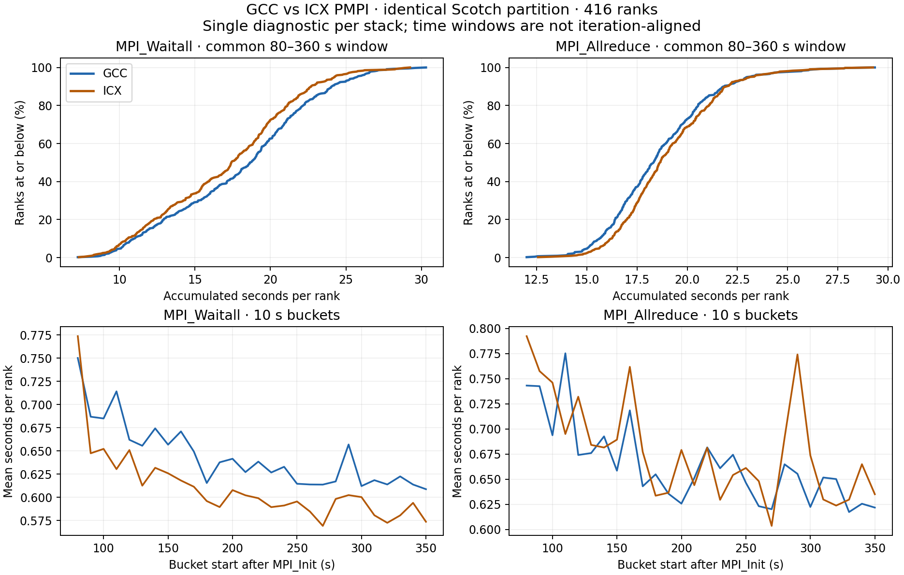

# Analysis: ICX vs GCC Scotch PMPI

## 1. Concise summary

2026-11-02本地复算：ICX诊断182940799成功，416份总报告和416份时间桶报告完整。GCC181908113的此前缺失原始求解日志已补齐；两套均完整150步、End、Cd有效。**相同分区和相同逐rank调用次数下，ICX的Waitall较少，而Allreduce没有改善。现有证据支持等待行为不同，不能将正式成绩约0.70%的差异归因于编译器或网络。**

## 2. Scope and evaluation criteria

固定65,334,765单元、Scotch416份、OpenFOAMv2512、私有OpenMPI5.0.10、4个SPR8470Q节点各104ranks、150步、默认binding；一套GCC16.2.0，一套ICX2025.3.2。CPU profile不是本报告内容。原始日志与诊断数据独立保留；没有提交新作业。

|核对项|结论/原始证据|
|---|---|
|科学输入|case-inputs.sha256与expected-source.sha256两套逐字节一致；run.log中校验OK|
|分区|10_decomposePar.log的416个单元/processor-face/boundary-face向量和全部对称邻居面数一致；去重边界面2,690,403、跨节点300,065|
|二进制|ICX7cc4af8c…，GCCb3b99261…；对应固定构建归档SHA见reviewed-script-diff.txt与各run.log的OK收据|
|MPI/插桩|同一OpenMPI归档SHA8ac121e4…，同一PMPIv2源SHAb3e8f318…、相同staging helper/10秒桶、均只给simpleFoam加LD_PRELOAD；所有14调用逐rank计数完全一致|
|插桩二进制|stage-pmpi-build-0.txt：GCC162c1d70…、ICXa0e84f38…；helper均以GCC16.2 mpicc -O2 -g构建，但二进制字节不相同；路径/debug/build-id等影响未分离，不能声称插桩二进制相同|
|运行时|同样pml=ucx、不显式排除HCOLL、默认绑定；ICX另加载intel-compiler-llvm模块。ldd解析到/usr/lib64/libucp.so.0、UCC/HCOLL；实际求解器UCX版本/collective选择与核心绑定未记录充分|
|节点|GCC SPR0181–0184，ICX SPR0325–0328，均104/node；节点、日期、环境非同一次分配配对|
|正确性/状态|两套150个Time与coefficient行、全准备链与solver End、PASS、PBS stdout Exit0；ICX fresh qstatF/0，GCC历史qstat已过期，保留Unknown Job Id原文|

## 3. Data and analysis

### 求解与成本

|配置|job|诊断秒/步|最终Cd|PBS walltime|实际SU|
|---|---|---:|---:|---|---:|
|GCC|181908113|1.993566906752|0.291875949275|17:48|246.83|
|ICX|182940799|1.984600097054|0.291876174404|17:40|244.98|

本次诊断ICX快0.4498%；既有无插桩两次均值GCC1.989910155、ICX1.975959161，ICX快0.7011%。相比各自历史无插桩均值，诊断增加GCC0.1838%、ICX0.4373%。**这是表观插桩偏移，混有日期/节点波动，不是严格测得的插桩开销，不能直接扣除作校正。** 149个coded计时样本对应150步中首步不计；PBS总时间含准备、启动编译与归档。

### 排除启动与共同窗口

GCC非root启动Barrier约63.958s，ICX约70.642s。v2按调用开始时间归桶，长Barrier整段落在0秒桶；不能把它平均摊进稳态通信。原有≥70s结果保留为敏感性检查；本报告主表采用**[80,360)s完整10秒桶**，两套均避开启动且覆盖相同280秒。桶以各rank MPI_Init后时间划分，**仍不是相同迭代号对齐**；调用会跨桶边界，时间按起点归属，不能将总MPI秒数直接当精确wall时间比例。

下表耗时为整个窗口内每rank累积调用内秒数的均值，绝非秒/步：

|调用|GCC均值(s/rank)|ICX均值(s/rank)|ICX相对变化|GCC p95|ICX p95|
|---|---:|---:|---:|---:|---:|
|MPI_Waitall|18.032006|17.082282|-5.27%|25.733105|24.252338|
|MPI_Allreduce|18.597991|19.007857|+2.20%|23.014442|23.140395|
|MPI_Isend|1.646119|1.655166|+0.55%|2.608059|2.596262|
|MPI_Irecv|0.237228|0.239913|+1.13%|0.364121|0.371144|
|MPI_Send|0.001521|0.001540|+1.26%|0.002286|0.002363|
|MPI_Recv|0.030702|0.029213|-4.85%|0.140195|0.135239|

捕获的非Barrier MPI调用均值39.3510→38.7736s/rank，约少1.47%。这不是端到端加速的可加分解，不能说它“解释了多少百分比”正式成绩。未计入的MPI函数、wrapper自身开销和计算/等待的相互影响仍存在。

### 计数与时间窗口敏感性

**完整运行**每个rank、全部14种wrapped调用计数逐项相同，包括全局Waitall82,432,885、Allreduce97,040,320、Isend/Irecv各914,203,155、Send/Recv各820,455。故没有“ICX少发消息”的证据；该wrapper不记录字节数或peer payload。Isend/Irecv计时只是启动请求，不是完成网络传输。

完整运行Waitall19.7710→18.5829s/rank，Allreduce21.3237→21.3863。≥70秒到各自末尾Waitall19.3620→18.2944，Allreduce20.0060→20.3420。共同[100,360)窗口Waitall16.5949→15.6611，Allreduce17.1124→17.4581。不同窗口均显示Waitall较少、Allreduce未改善；差值大小对窗口敏感。完整统计包含启动阶段其他非Barrier调用，不能直接叫稳态。

### Rank负载与分区

主窗口Waitall与processor-face相关系数GCC0.479、ICX0.468，分区本身不变。GCC等待最长rank112(30.302s)，ICX为rank285(29.246s)，ICX rank112仍在第二(28.861s)。等待热点大体相似、具体名次变化。每rank单元与边界分布匹配说明几何负载相同，不代表实际CPU工作量/邻居计算进度相同。完整逐rank及各节点分布见rank-metrics.csv与summary.json。

## 4. Insights gained

1. 有限结论：在本次单次诊断中，ICX用相同调用数量完成相同分区，伴随较少Waitall。不能将其解释成较少消息量、更快网卡或编译器独立收益。
2. Allreduce主窗口略多，因此没有证据指向“更快collective是ICX优势来源”；默认component和实际库仍未知。
3. 正式差0.70%很小；诊断差0.45%、表观插桩偏移、不同节点和历史runtime缺口都必须保留。两次正式重复和每套一次profile不足以给出可靠因果归属。
4. CPU profile尚不能由这些数据替代；MPI调用外的时间也不能一概称为有效CPU计算。没有执行CPU采样或新硬件计数器测量。

PPT: **With identical Scotch partitions and per-rank MPI call counts, the ICX diagnostic shows lower Waitall time but no Allreduce improvement; compiler-only causality remains unproven.**

## 5. Suggested next section

优先整理已有ICX CPU profile（若尚未运行，则按现有审查草案及批准流程推进），比较具名求解器函数的绝对采样成本与GCC，而不是百分比份额。其次若要检验Waitall差异来源，设计同节点、同运行时、相同binding的配对诊断，记录实际solver通信库与核心亲和性并尽可能按迭代对齐；需要新的diff/预算批准。本报告不授权额外四节点或flag sweep。不建议仅因这次结果盲试Allreduce flags；先解决runtime和placement证据缺口。新的NUMA候选也不能用本次profile证明有效。

## 6. Provenance

- [ICX原始日志](../../evidence/gadi-pbs-script-snapshot/logs/182940799.gadi-pbs/README.md)，[simpleFoam.log](../../evidence/gadi-pbs-script-snapshot/logs/182940799.gadi-pbs/simpleFoam.log)，[coefficient.dat](../../evidence/gadi-pbs-script-snapshot/logs/182940799.gadi-pbs/coefficient.dat)。
- [GCC原始日志](../../evidence/gadi-pbs-script-snapshot/logs/181908113.gadi-pbs/README.md)，此前缺失的PBS stdout及阶段/求解日志已补齐；旧README的缺项描述作为历史保留。
- [结构化结果](../../../results/gadi-icx20253-ompi5010-scotch/pmpi-comparison-2026-11-02.csv)，[逐rank数据](rank-metrics.csv)，[所有窗口](summary.json)，[复算脚本](analyze.py)，[绘图脚本](plot.py)，[本地审阅脚本diff](reviewed-script-diff.txt)。审阅快照来自本地git2010d33，不伪称是PBS保存的提交脚本原件。
- SHA256SUMS逐文件对照远端sha256sum后归档；没有修改远端文件、重复PBS或覆盖历史证据。
